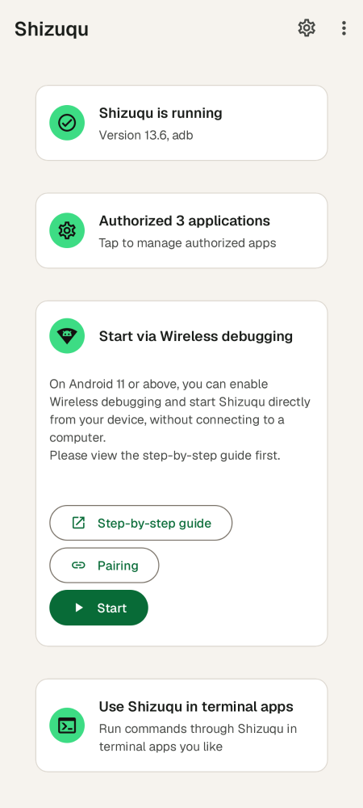
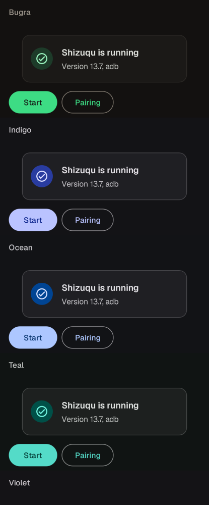

<p align="center"></p>

<h1 align="center">Shizuqu</h1>

<p align="center">Shizuku for Android 17. Same API, same apps, fixed for API 37.</p>

<p align="center"><a href="https://github.com/bugragungoz/shizuqu/actions/workflows/app.yml"></a></p>

> App name, package name, version and links are set in
> [`branding.properties`](branding.properties) - see [docs/RENAMING.md](docs/RENAMING.md).

An **Android 17 (API 37) compatible fork of [Shizuku](https://github.com/RikkaApps/Shizuku)**.
It is a drop-in replacement: every app that uses the Shizuku API keeps working,
no change needed on their side.

Upstream Shizuku 13.6.0 has not been updated since June 2025. On Android 17 its
"Authorized applications" list is empty and apps that were already running when
the service started never get access. This fork fixes that, verified against the
real Android 17.0 and 17.1 framework and the AOSP `android17-release` sources.

[Türkçe kullanım kılavuzu → README_TR.md](README_TR.md)

<p align="center">
  
  
  
</p>

## What is fixed

| Problem on Android 17 | Cause | Fix |
|---|---|---|
| Authorized apps list shows 0 apps | `IPackageManager.getInstalledPackages()` returns `PackageInfoList` now; the old call throws `NoSuchMethodError`, swallowed into an empty list | API 37 signature first, old one and a reflection fallback after |
| Apps already running when the service starts get no binder ("Shizuku is not running") | same empty list in `sendBinderToClient()` | same fix |
| Apps in a work profile, Samsung Secure Folder or Dual Messenger never get access | `IUserManager.getUsers(boolean, boolean, boolean)` was removed; only user 0 was seen | `getUsers(boolean)` on API 37 |
| Hidden API access in the manager on 17 / 17.1 | HiddenApiBypass 6.1 | 6.2 |
| User services crash on some OEM ROMs (HyperOS, ...) | OEM code reads the bound application in `makeApplication` | retry with a minimal `AppBindData` |
| "Start on boot" without root almost never worked | 3 s window, usually before Wi-Fi is up | short foreground service that waits for Wi-Fi and retries |

Details and evidence: [docs/ANDROID17.md](docs/ANDROID17.md).

Also in this fork:

* **Quick Settings tile**: shows whether the service runs and starts it with
  one tap after a reboot (no root, Android 13+).
* **Copy log** on the start screen, with the app, Android and device versions,
  for bug reports.
* [`tools/hiddenapi-check`](tools/hiddenapi-check): finds every framework method
  an APK calls that does not exist on a given Android build. CI runs it against
  Android 17.0 and 17.1 on every push. Upstream 13.6.0 fails it, this fork passes.
* CI also runs lint (0 errors) and Robolectric tests: every screen in every
  palette, the tile's start rules, the wireless debugging port discovery.
* The hidden API layer ([RikkaW/HiddenApi](https://github.com/RikkaW/HiddenApi))
  and the client API ([Shizuku-API](https://github.com/RikkaApps/Shizuku-API)) are
  vendored as plain directories, so they can be fixed in the same commit.
* Own icon and all branding in one file ([`branding.properties`](branding.properties)).

## Look and feel

Shizuku's screens and flow, in the Bugra design system on Material 3:

* **Palettes**: Bugra (default: warm black, Android green), Material You
  (wallpaper colors, Android 12+), Indigo, Ocean, Teal, Violet, Rose, Amber and
  Graphite. Settings > Appearance > Color palette. Each one has light, dark and
  black variants.
* **Type**: Geist for the interface, JetBrains Mono for commands and logs.
* **Shape**: flat cards with a hairline border, 14dp corners, one filled
  action per card.
* **Icon**: a terminal window with Android's antennae and a `>_` prompt, also
  as a themed icon (Android 13+).

Every screen above is rendered from the real layouts by the screenshot tests
(`./gradlew :manager:recordPaparazziDebug -Pscreenshots`, no device needed).

## Install

1. Uninstall the original Shizuku (same package name by default, different signature).
2. Install the APK (a GitHub release, a GitHub Actions build, or build it, see below).
3. Open the app and start the service:
   * **Without root, Android 11+**: Developer options > Wireless debugging > on,
     allow the current Wi-Fi network, then use "Pair" and "Start" in the app.
   * With root: "Start" in the root card.
   * From a computer: `adb shell <path shown in the app>`.
4. Open the apps that use Shizuku and grant access again (uninstalling the
   original Shizuku removes its permission grants).

Samsung (One UI 9): turn off **Auto Blocker** while pairing/starting, and see
[docs/ANDROID17.md §7](docs/ANDROID17.md#7-samsung-one-ui-9).

After a reboot (no root), the **Quick Settings tile** starts the service with
one tap: Settings > "Add Quick Settings tile", or add "Shizuqu" by editing
Quick Settings. It needs Android 13+ and one start from the app before; on
the lock screen it asks to unlock first.

If starting fails, **Copy log** on the start screen copies the log with the
app, Android and device versions for a bug report.

## Build

```bash
git clone https://github.com/bugragungoz/shizuqu.git && cd shizuqu
echo "sdk.dir=$ANDROID_HOME" > local.properties
./gradlew :manager:assembleRelease
```

JDK 21, `platforms;android-37.0`, `build-tools;36.0.0`, `ndk;29.0.14206865`,
`cmake;3.31.6`. Signing and CI secrets: [docs/BUILDING.md](docs/BUILDING.md).

## For app developers

Nothing changes in the API, but Android 17 changed hidden APIs your app may
call through `ShizukuBinderWrapper`. See [docs/CLIENT_APPS.md](docs/CLIENT_APPS.md).

## Documentation

* [docs/ANDROID17.md](docs/ANDROID17.md) - what broke and how it was fixed
* [docs/CLIENT_APPS.md](docs/CLIENT_APPS.md) - writing/updating apps that use Shizuku on Android 17+
* [docs/UPDATING_FOR_NEW_ANDROID.md](docs/UPDATING_FOR_NEW_ANDROID.md) - maintenance runbook for the next Android version
* [docs/RENAMING.md](docs/RENAMING.md) - renaming the app / going public
* [docs/BUILDING.md](docs/BUILDING.md) - building, signing, CI
* [docs/SAFETY.md](docs/SAFETY.md) - what the app changes on the phone, risks, how to undo
* [CHANGELOG.md](CHANGELOG.md) - everything this fork changes
* [CONTRIBUTING.md](CONTRIBUTING.md), [SECURITY.md](SECURITY.md) - pull requests, reporting vulnerabilities

## How Shizuku works (short)

The manager starts a process (the "server") through adb or root. Its uid is
2000 (shell) or 0 (root). The server sends its binder to every app that
declares the `moe.shizuku.manager.permission.API_V23` permission, through
that app's `<package>.shizuku` content provider. Apps then forward binder
calls to system services through the server (`ShizukuBinderWrapper`), or run
their own code in a process started by the server (user services). See
[upstream's README](https://github.com/RikkaApps/Shizuku#how-does-shizuku-work)
for the full explanation.

## License

Code: Apache License 2.0 ([LICENSE](LICENSE)), as upstream. `hidden-api/`: MIT.
See [NOTICE](NOTICE).

Upstream asks (Apache 2.0 section 6) not to use its launcher icons, and not to
publish to app stores an APK named "Shizuku", using the
`moe.shizuku.privileged.api` application id or declaring
`moe.shizuku.manager.permission.*` permissions. This fork has its own name and
icons; keep it to GitHub releases / personal use. See
[docs/RENAMING.md](docs/RENAMING.md#before-making-it-public-or-publishing-it).

## Credits

* [Shizuku](https://github.com/RikkaApps/Shizuku) by RikkaApps and its
  contributors: the original app this fork is based on (upstream `b844bc49`,
  13.6.0), Apache License 2.0.
* [Shizuku-API](https://github.com/RikkaApps/Shizuku-API) (`api/`), Apache
  License 2.0, and [HiddenApi](https://github.com/RikkaW/HiddenApi)
  (`hidden-api/`), MIT, both by RikkaW.
* [HiddenApiBypass](https://github.com/LSPosed/AndroidHiddenApiBypass) by
  LSPosed, Apache License 2.0.
* [Geist](https://github.com/vercel/geist-font) and
  [JetBrains Mono](https://github.com/JetBrains/JetBrainsMono) fonts, SIL Open
  Font License 1.1 (license texts ship in the app under `assets/licenses`).
* Translations: the Shizuku translators on Crowdin.
* Built with [Claude Code](https://claude.com/claude-code) (Anthropic).

See [NOTICE](NOTICE) for the license notices.
