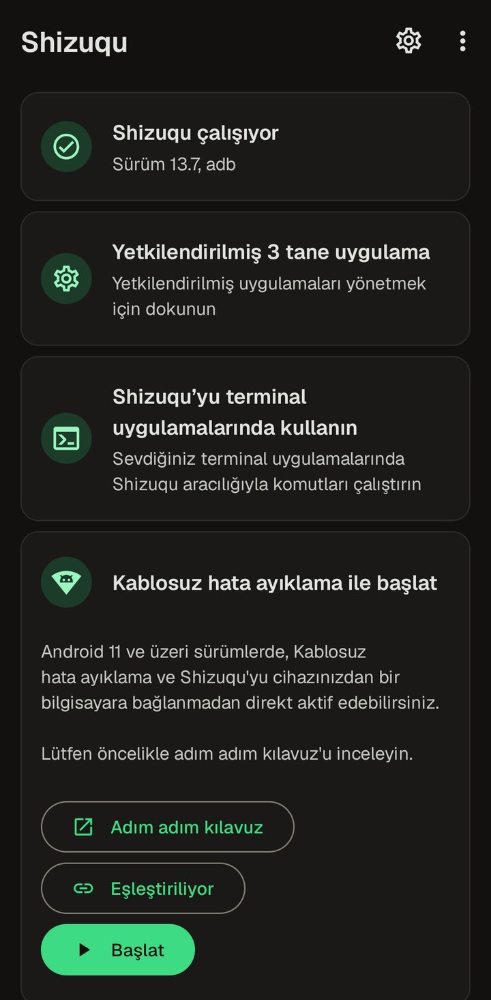
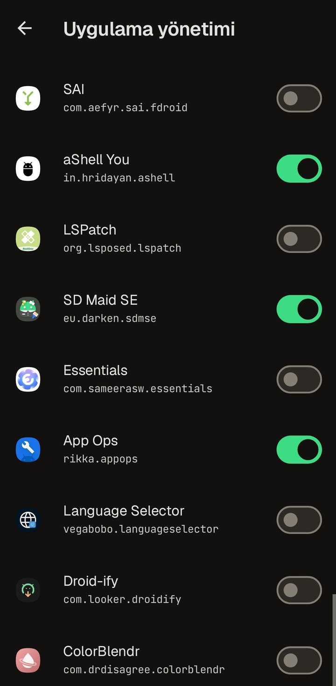

<h1 align="center">Shizuqu</h1>

Shizuku for Android 17. Same API, same apps.

On Android 17, [Shizuku](https://github.com/RikkaApps/Shizuku) shows an empty
list of authorized apps and apps can no longer connect to it. Shizuqu is a fork
that fixes this. Apps that use the Shizuku API work with it unchanged.

> [!NOTE]
> Shizuqu is an unofficial, temporary fork. It was made before Shizuku had an
> update for Android 17. When RikkaApps releases a Shizuku version that
> supports Android 17, switch back to the official Shizuku. Shizuqu is not
> affiliated with or endorsed by RikkaApps or Google.

[Türkçe](docs/README_TR.md)

  
  

## Download

Get the APK from **[Releases](https://github.com/bugragungoz/shizuqu/releases/latest)**
(Android 7.0+). The release notes list its SHA-256.

Uninstall the original Shizuku first. Both use the same package name with
different signatures, so they cannot be installed side by side. To switch back
later, uninstall Shizuqu, install Shizuku, and allow your apps again.

## Start the service

* **Without root (Android 11+):** turn on Developer options > Wireless
  debugging and allow the Wi-Fi network. Then tap Pair in the app, and then
  Start.
* **Root:** tap Start on the root card.
* **From a computer:** `adb shell` followed by the command shown in the app.

Without root, the service stops on every reboot. You can start it again with
one tap from the Quick Settings tile (Android 13+), or turn on Settings >
Start on boot. On Samsung phones, turn off Auto Blocker while pairing.

## What is different from Shizuku

* **Android 17 fixes:** the authorized apps list works again. Apps that were
  already running when the service started can connect. Apps in a work
  profile, Secure Folder or Dual Messenger are found. Details are in
  [docs/ANDROID17.md](docs/ANDROID17.md).
* **Start on boot without root**, and a **Quick Settings tile**.
* **New design** on Material 3:
  * Material You plus eight color palettes. The default is Bugra: warm black
    with Android green.
  * Geist and JetBrains Mono fonts.
  * A new icon.
* **Copy log** on the start screen, for bug reports.
* **Checked in CI:** every build is checked against the Android 17.0 and 17.1
  framework, with tests and lint.

## Safety

Without root, the service has the same rights as `adb shell`. It cannot
write to the system partitions, the bootloader or Knox, and a reboot stops
it. Apps you allow get these same rights, so only allow apps you trust.
Uninstalling Shizuqu undoes everything.

## For developers

* Apps that use Shizuku: [docs/CLIENT_APPS.md](docs/CLIENT_APPS.md)
* Building, signing, renaming, and the next Android version:
  [docs/DEVELOPMENT.md](docs/DEVELOPMENT.md)
* All changes: [CHANGELOG.md](CHANGELOG.md)

## Credits

* [Shizuku](https://github.com/RikkaApps/Shizuku) by RikkaApps and its
  contributors, the app this fork is based on.
* [Shizuku-API](https://github.com/RikkaApps/Shizuku-API) and
  [HiddenApi](https://github.com/RikkaW/HiddenApi) by RikkaW.
* [HiddenApiBypass](https://github.com/LSPosed/AndroidHiddenApiBypass) by LSPosed.
* The [Geist](https://github.com/vercel/geist-font) and
  [JetBrains Mono](https://github.com/JetBrains/JetBrainsMono) fonts (SIL OFL 1.1).
* The Shizuku translators.
* The icon uses the Android robot. The Android robot is reproduced or modified
  from work created and shared by Google and used according to terms described
  in the [Creative Commons 3.0 Attribution License](https://creativecommons.org/licenses/by/3.0/).
* Built with [Claude Code](https://claude.com/claude-code) (Opus 5.5).

## License

Apache License 2.0, the same as upstream; `hidden-api/` is MIT. See
[NOTICE](NOTICE).

"Shizuku" and its icons belong to the upstream project. Shizuqu has its own
name and icon, and is distributed only through GitHub. Android is a trademark
of Google LLC.
