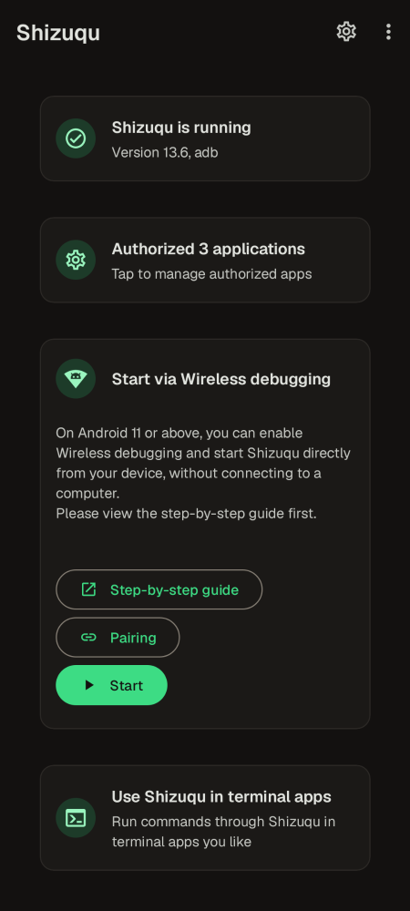
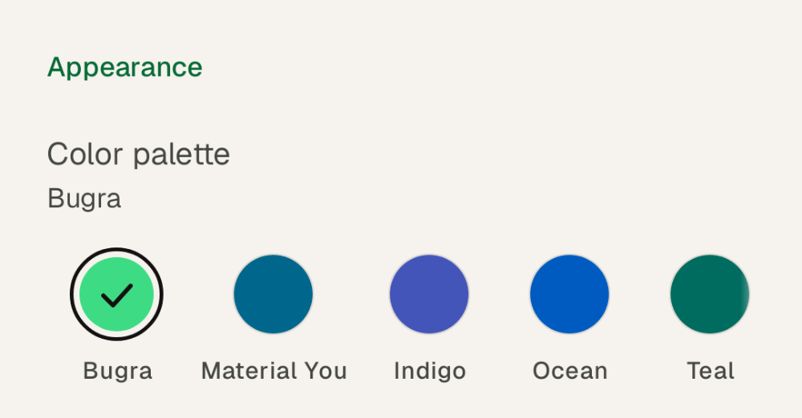

<p align="center"></p>

# Shizuqu — Türkçe kılavuz

Shizuku'nun **Android 17 (API 37) ile uyumlu** fork'u. Shizuku kullanan bütün
uygulamalar (App Ops, Swift Backup, Hail, Canta, InstallWithOptions, ...)
hiçbir değişiklik gerekmeden bununla çalışır; protokol aynıdır.

İsim, paket adı ve dosya adı tek dosyadan değişir:
[`branding.properties`](branding.properties) → [docs/RENAMING.md](docs/RENAMING.md).

<p align="center">
  
  
</p>

## Görünüm

Ekranlar ve akış orijinal Shizuku ile aynı; tasarım Material 3 üzerinde Bugra
tasarım sistemi:

* **Renk paletleri** (Ayarlar > Görünüm > Renk paleti): Bugra (varsayılan, sıcak
  siyah ve Android yeşili), Material You (duvar kağıdı renkleri, Android 12+),
  Çivit, Okyanus, Turkuaz, Menekşe, Gül, Kehribar, Grafit. Hepsinin açık, koyu
  ve siyah hâli var.
* **Yazı tipi**: arayüzde Geist, komut ve loglarda JetBrains Mono.
* **İkon**: Android antenli bir terminal penceresi ve `>_` komut istemi;
  Android 13+ temalı ikon desteğiyle.

## Android 17'de orijinal Shizuku neden bozuldu?

Gerçek Android 17.0 / 17.1 framework'ü ve AOSP `android17-release` kaynak kodu
incelenerek bulundu (ayrıntı: [docs/ANDROID17.md](docs/ANDROID17.md)):

1. **Uygulama listesi boş görünüyor:** Android 17'de
   `IPackageManager.getInstalledPackages()` artık `ParceledListSlice` yerine
   `PackageInfoList` döndürüyor. Eski çağrı `NoSuchMethodError` veriyor, Shizuku
   bu hatayı yutup boş liste döndürüyordu.
2. **Uygulamalar Shizuku'ya bağlanamıyor:** Aynı boş liste yüzünden servis
   başlarken, o an açık olan uygulamalara bağlantı (binder) gönderilmiyordu.
   Uygulama "Shizuku çalışmıyor" diyordu.
3. **Güvenli Klasör / Dual Messenger / iş profili:** Android 17'de
   `IUserManager.getUsers(boolean, boolean, boolean)` kaldırıldı. Orijinal kod
   sadece ana kullanıcıyı (0) görüyordu; Samsung'un Güvenli Klasörü (kullanıcı
   150) ve Dual Messenger (kullanıcı 95) içindeki uygulamalar hiç erişemiyordu.
4. Uygulama içi gizli API erişimi için HiddenApiBypass 6.2'ye geçildi (Android
   17 / 17.1 düzeltmeleri içeriyor).
5. Root'suz "açılışta başlat" özelliği neredeyse hiç çalışmıyordu (3 saniyelik
   pencere, Wi-Fi bağlanmadan bitiyordu). Artık Wi-Fi'yi bekleyen ve tekrar
   deneyen kısa bir servis var.
6. Bazı üretici ROM'larında (HyperOS vb.) kullanıcı servisleri çöküyordu;
   güvenli bir yedek yol eklendi.

## Güvenlik: telefonuma zarar verebilir mi?

Hayır, telefonu "brick" edemez. Root olmadan servis `shell` kullanıcısıyla
(bilgisayardan `adb shell` ile aynı yetki) çalışır: sistem/boot bölümlerine
yazamaz, bootloader'a dokunamaz, root yapmaz, Knox'u bozmaz. Telefonu yeniden
başlatınca servis tamamen kapanır ("Sistem açılışında başlat" varsayılan olarak
kapalıdır).

Uygulamanın değiştirdiği şeyler bunlarla sınırlı: kendine `WRITE_SECURE_SETTINGS`
izni verir, başlatma ekranında kablosuz/USB hata ayıklamayı açar, ADB
yetkilerinin 7 günde düşmesini kapatır ve hangi uygulamalara izin verdiğinizi
küçük bir dosyada tutar. Tam liste ve geri alma adımları:
[docs/SAFETY.md](docs/SAFETY.md).

Asıl risk, **izin verdiğiniz uygulamalardır**: shell yetkisiyle sistem
uygulamalarını kaldırabilir/devre dışı bırakabilirler (ör. debloater'lar). Sadece
güvendiğiniz uygulamalara izin verin; tanımadığınız sistem paketlerini
kaldırmayın. Bir sorun olursa: yeniden başlatın, Shizuqu'yu kaldırın veya
Geliştirici seçeneklerini kapatın.

## Kurulum (Galaxy A35, One UI 9, Android 17)

1. **Orijinal Shizuku'yu kaldırın.** Varsayılan paket adı aynı
   (`moe.shizuku.privileged.api`, uygulamalar Shizuku'yu bu adla arıyor) ama imza
   farklı, üzerine kurulmaz.
2. APK'yı kurun (GitHub Actions çıktısı veya kendiniz derleyin, aşağıda).
3. **Ayarlar > Güvenlik ve gizlilik > Otomatik Engelleyici (Auto Blocker)**
   açıksa başlatma sırasında kapatın; USB/kablosuz hata ayıklama komutlarını
   engelliyor.
4. **Geliştirici seçenekleri** açık değilse: Ayarlar > Telefon hakkında >
   Yazılım bilgileri > "Yapım numarası"na 7 kez dokunun.
5. Geliştirici seçenekleri > **Kablosuz hata ayıklama**'yı açın; "Bu ağda
   kablosuz hata ayıklamaya izin verilsin mi?" sorusuna **İzin ver** deyin
   (açılışta başlatma için "Bu ağda her zaman izin ver" işaretleyin).
6. Uygulamada **Eşleştir**'e basın. Bildirim gelince, Kablosuz hata ayıklama >
   "Eşleştirme kodu ile cihaz eşleştir" ekranındaki 6 haneli kodu bildirimin
   cevap alanına yazın. (Bildirim görünmüyorsa Ayarlar'ı bölünmüş ekran veya
   açılır pencere ile açın.)
7. Uygulamada **Başlat**'a basın. "Çalışıyor" görününce bitti.
8. Shizuku kullanan uygulamaları açıp erişim iznini **yeniden** verin (orijinal
   Shizuku kaldırılınca verdiği izinler de silinir).

Servis telefon yeniden başlayana kadar çalışır. Root yoksa her yeniden
başlatmadan sonra tekrar başlatmak gerekir. İsterseniz Ayarlar > **Sistem
açılışında başlat**'ı açabilirsiniz (varsayılan kapalı; Android 13+, son
başlatma kablosuz hata ayıklama ile yapılmış olmalı, izin verilen bir Wi-Fi ağı
gerekli). Açıkken her açılışta kablosuz hata ayıklamayı kendisi açar.

### Sorun giderme

| Belirti | Çözüm |
|---|---|
| Eşleştirme servisi bulunamıyor | Wi-Fi'ye bağlı olun, kablosuz hata ayıklama açık ve bu ağa izin verilmiş olsun; Otomatik Engelleyici kapalı olsun |
| Başlat'ta "bağlanılamıyor" | Kablosuz hata ayıklamayı kapatıp açın, tekrar eşleştirin |
| Uygulama listede yok | Uygulama Shizuku izni istemiş olmalı (bir kez açın); liste yalnızca Shizuku API kullanan uygulamaları gösterir |
| Uygulama "Shizuku çalışmıyor" diyor | Uygulamayı kapatıp açın; hâlâ olmuyorsa servisi yeniden başlatın |
| Telefon yeniden başlayınca durdu | Root olmadan normal; "Sistem açılışında başlat"ı açın veya elle başlatın |
| Başlatma başarısız, sebebi belli değil | Başlatma ekranında sağ üstteki **Kaydı kopyala** ile kaydı (uygulama, Android ve cihaz sürümüyle) alıp hata bildirimine yapıştırın |

## Takip edilen risk: cihaz içi ADB kısıtlaması

Google, Temmuz 2026'da adbd'nin sadece Wi-Fi arayüzünü (`wlan0`) dinlemesini
tartışmaya açtı; bu, Shizuku'nun telefondan kendi kendine başlatılmasını
(127.0.0.1 bağlantısı) kırar. Ekim 2026 itibarıyla karar yok, Android 17 kaynak
kodu hâlâ tüm arayüzleri dinliyor. Fork buna karşı şimdiden hazır: 127.0.0.1
reddedilirse telefonun kendi Wi-Fi IP adresine bağlanmayı deniyor. Bu da
çalışmazsa bilgisayardan `adb shell` ile başlatma veya root/Sui yolu kalır.
Ayrıntı: [docs/ANDROID17.md §8](docs/ANDROID17.md#8-watch-list-restricting-on-device-adb).

## Derleme

```bash
git clone https://github.com/bugragungoz/shizuqu.git && cd shizuqu
echo "sdk.dir=$ANDROID_HOME" > local.properties
./gradlew :manager:assembleRelease
```

Gerekenler: JDK 21, Android SDK `platforms;android-37.0`, `build-tools;36.0.0`,
`ndk;29.0.14206865`, `cmake;3.31.6`.

**İmza anahtarı:** Güncellemelerin eski sürümün üstüne kurulabilmesi için hep
aynı anahtarla imzalanması gerekir. Anahtar (`signing/release.p12`) repoda,
AES-256 ile şifreli duruyor; şifre repoda yok. GitHub'da bir kez
**Settings > Secrets and variables > Actions > New repository secret** ile
`KEYSTORE_PASSWORD` adında, değeri size verdiğim şifre olan bir secret ekleyin.
Sonra her push'ta Actions sekmesindeki APK, telefondakinin üstüne güncelleme
olarak kurulur. Ayrıntı: [signing/README.md](signing/README.md).

## Shizuku kullanan kendi uygulamanız için

Shizuku API'sinde değişiklik yok; resmi `dev.rikka.shizuku:api` kütüphanesi bu
fork ile çalışır. Ama uygulamanız `ShizukuBinderWrapper` ile gizli sistem
API'leri çağırıyorsa, Android 17'de değişenleri kendi kodunuzda da düzeltmeniz
gerekir (`getInstalledPackages`, `getUsers`, izin API'leri, `adb_enabled`'ın
uygulamalara 0 görünmesi, `targetSdk 37` ile gelen yerel ağ izni...). Hepsi
örnek kodlarıyla: [docs/CLIENT_APPS.md](docs/CLIENT_APPS.md).

Bir sonraki Android sürümü (18) veya QPR çıktığında yapılacaklar adım adım:
[docs/UPDATING_FOR_NEW_ANDROID.md](docs/UPDATING_FOR_NEW_ANDROID.md). Kısaca:
telefondan `adb pull /system/framework/framework.jar` alın,
`tools/hiddenapi-check/check.py` ile APK'yı kontrol edin; eksik çıkan her
çağrıyı `hidden-api/` içinde düzeltin.

## Kaynakça

* [Shizuku](https://github.com/RikkaApps/Shizuku) (RikkaApps ve katkıda
  bulunanlar): bu fork'un temel aldığı orijinal uygulama, Apache 2.0.
* [Shizuku-API](https://github.com/RikkaApps/Shizuku-API) ve
  [HiddenApi](https://github.com/RikkaW/HiddenApi) (RikkaW),
  [HiddenApiBypass](https://github.com/LSPosed/AndroidHiddenApiBypass) (LSPosed).
* [Geist](https://github.com/vercel/geist-font) ve
  [JetBrains Mono](https://github.com/JetBrains/JetBrainsMono) yazı tipleri
  (SIL Open Font License 1.1).
* Çeviriler: Crowdin'deki Shizuku çevirmenleri.
* [Claude Code](https://claude.com/claude-code) (Anthropic) ile geliştirildi.

Lisans bildirimleri: [NOTICE](NOTICE).

## Lisans

Kod Apache 2.0 (upstream ile aynı), `hidden-api/` MIT. Upstream, "Shizuku"
adını, kendi ikonlarını ve `moe.shizuku.privileged.api` paket adını
**uygulama mağazalarında** (Google Play, F-Droid...) kullanmayı yasaklıyor. Bu
fork kendi adını ve ikonunu kullanıyor; GitHub üzerinden dağıtım ve kişisel
kullanım sorun değil. Repoyu public yapmadan önce:
[docs/RENAMING.md](docs/RENAMING.md#before-making-it-public-or-publishing-it).
